# Escrow Lifecycle

This document traces a single trade through the five steps described in the
[README's Amana Flow](../README.md#-how-it-works-the-amana-flow):
**Deposit → Lock → Dispatch → Verify → Settlement**.

The diagram below is the authoritative end-to-end sequence: it shows which actor
initiates each step, which API endpoint builds the transaction, which Soroban
contract function actually moves state, which on-chain event the backend mirrors,
and where off-chain evidence (IPFS) and metadata (Postgres) fit in. The backend
never holds a user's signing key - every state-changing contract call is built by
the API as an **unsigned Stellar transaction (XDR)**, signed in the user's wallet,
and submitted to the network by the client.

For the event-ingestion details (polling, deduplication, outbox retries, webhooks)
see [event-flow.md](./event-flow.md). For the off-chain data model see
[data-model-relationships.md](./data-model-relationships.md). For the loss-sharing
math applied at settlement see
[ADR-002](./adr/ADR-002-escrow-loss-sharing-model.md).

## Lifecycle sequence

```mermaid
sequenceDiagram
    autonumber
    actor Buyer
    actor Seller
    actor Mediator
    participant Client as Client app<br/>Next.js web / Expo mobile
    participant Wallet as Stellar wallet<br/>Freighter / Albedo
    participant API as Backend API
    participant RPC as Stellar network<br/>Soroban RPC + Horizon
    participant Escrow as Amana escrow contract
    participant Token as USDC token contract
    participant IPFS as IPFS via Pinata
    participant DB as Postgres<br/>Supabase / Prisma

    rect rgb(235, 244, 255)
    Note over Buyer,Escrow: Step 1 - Deposit: initiate the trade with its funding terms
    Buyer->>Client: Select seller, amount and loss split
    Client->>API: POST /trades with sellerAddress, amountUsdc, buyerLossBps, sellerLossBps
    API->>DB: Store trade intent as PENDING_SIGNATURE
    API->>RPC: Simulate and assemble create_trade invocation
    API-->>Client: 201 tradeId and unsignedXdr
    Client->>Wallet: Request signature for create_trade
    Wallet->>RPC: Submit signed transaction
    RPC->>Escrow: create_trade with buyer, seller, amount, loss bps and expiry
    Note over Escrow: Status Created - loss ratios now immutable for this trade
    Escrow-->>RPC: TradeCreatedEvent with topic TRDCRT
    API->>RPC: getEvents poll from last processed ledger
    RPC-->>API: TradeCreatedEvent payload
    API->>DB: Mirror trade as CREATED with version 1
    end

    rect rgb(236, 250, 242)
    Note over Buyer,Token: Step 2 - Lock: deposit moves funds into escrow
    Buyer->>Client: Choose deposit amount and confirm
    Client->>API: POST /trades/:id/deposit
    API->>RPC: Simulate and assemble deposit invocation
    API-->>Client: unsignedXdr for deposit
    Client->>Wallet: Request signature for deposit
    Wallet->>RPC: Submit signed transaction
    RPC->>Escrow: deposit with trade_id
    Escrow->>Token: Transfer trade amount from buyer to escrow contract
    Token-->>Escrow: Transfer confirmed
    Note over Escrow,Token: Funds are locked in escrow until release, refund or dispute settlement
    Escrow-->>RPC: TradeFundedEvent with topic TRDFND
    API->>RPC: getEvents poll
    RPC-->>API: TradeFundedEvent payload
    API->>DB: Mirror trade as FUNDED and set fundedAt
    end

    rect rgb(255, 248, 235)
    Note over Seller,Escrow: Step 3 - Dispatch: seller records the driver and vehicle
    Seller->>Client: Enter driver name, ID, vehicle, route and expected delivery
    Client->>API: POST /trades/:id/manifest
    API->>DB: Store plaintext manifest plus SHA-256 hashes of driver name and ID
    API-->>Client: 201 manifestId and unsignedXdr for submit_manifest
    Client->>Wallet: Request signature for submit_manifest
    Wallet->>RPC: Submit signed transaction
    RPC->>Escrow: submit_manifest with trade_id, seller and driver hashes
    Escrow-->>RPC: ManifestSubmittedEvent with topic MNFST
    Note over Seller,Buyer: Goods travel with the driver - this leg is off-chain
    end

    rect rgb(245, 238, 255)
    Note over Buyer,Escrow: Step 4 - Verify: proof of delivery and confirmation
    Buyer->>Client: Record proof-of-delivery video on arrival
    Client->>API: POST /evidence/video
    API->>IPFS: Pin video file
    IPFS-->>API: Content identifier CID
    API->>DB: Store TradeEvidence with cid, mimeType and uploadedBy
    API-->>Client: unsignedXdr for submit_video_proof
    Client->>Wallet: Request signature for submit_video_proof
    Wallet->>RPC: Submit signed transaction
    RPC->>Escrow: submit_video_proof with trade_id, buyer and ipfs_cid
    Escrow-->>RPC: VideoProofSubmittedEvent with topic VIDPRF
    Buyer->>Client: Confirm goods received in full
    Client->>API: POST /trades/:id/confirm
    API-->>Client: unsignedXdr for confirm_delivery
    Client->>Wallet: Request signature for confirm_delivery
    Wallet->>RPC: Submit signed transaction
    RPC->>Escrow: confirm_delivery with trade_id
    Escrow-->>RPC: DeliveryConfirmedEvent with topic DELCNF
    API->>RPC: getEvents poll
    RPC-->>API: DeliveryConfirmedEvent payload
    API->>DB: Mirror trade as DELIVERED and set deliveredAt
    end

    rect rgb(255, 240, 240)
    Note over Buyer,Token: Step 5 - Settlement: release or dispute resolution
    alt Goods accepted
        Buyer->>Client: Release escrowed funds
        Client->>API: POST /trades/:id/release
        API-->>Client: unsignedXdr for release_funds
        Client->>Wallet: Request signature for release_funds
        Wallet->>RPC: Submit signed transaction
        RPC->>Escrow: release_funds with trade_id and caller
        Escrow->>Escrow: Compute platform fee from fee_bps
        Escrow->>Token: Transfer fee to treasury
        Escrow->>Token: Transfer net amount to seller
        Note over Escrow,Token: Status Completed - FundsReleasedEvent with topic RELSD
    else Goods damaged, short or missing
        Buyer->>Client: Open a dispute with a reason and category
        Client->>API: POST /trades/:id/dispute
        API->>DB: Store Dispute as OPEN
        API-->>Client: unsignedXdr for initiate_dispute
        Client->>Wallet: Request signature for initiate_dispute
        Wallet->>RPC: Submit signed transaction
        RPC->>Escrow: initiate_dispute with trade_id, initiator and reason_hash
        Escrow-->>RPC: DisputeInitiatedEvent with topic DISINI
        API->>RPC: getEvents poll
        RPC-->>API: DisputeInitiatedEvent payload
        API->>DB: Mirror trade as DISPUTED
        Buyer->>Client: Upload damage evidence
        Client->>API: POST /evidence/video or POST /evidence
        API->>IPFS: Pin evidence file
        IPFS-->>API: Content identifier CID
        API->>DB: Store TradeEvidence for the dispute
        API-->>Client: unsignedXdr for submit_evidence
        Client->>Wallet: Request signature for submit_evidence
        Wallet->>RPC: Submit signed transaction
        RPC->>Escrow: submit_evidence with trade_id, caller, ipfs_hash and description_hash
        Escrow-->>RPC: EvidenceSubmittedEvent with topic EVDSUB
        Mediator->>Client: Review manifest, video proof and evidence
        Client->>API: Submit seller_gets_bps ruling
        API->>RPC: Read requires_quorum for the trade value via Soroban RPC
        alt Below the quorum threshold
            API-->>Client: unsignedXdr for resolve_dispute
            Client->>Wallet: Request mediator signature
            Wallet->>RPC: Submit signed transaction
            RPC->>Escrow: resolve_dispute with trade_id, mediator and seller_gets_bps
        else At or above the quorum threshold
            API-->>Client: unsignedXdr for cast_dispute_vote
            Client->>Wallet: Request mediator signature
            Wallet->>RPC: Submit signed transaction
            RPC->>Escrow: cast_dispute_vote with trade_id, mediator, outcome and rationale_hash
            Note over Escrow: Weighted votes settle at required_weight, otherwise resolve_dispute_by_fallback applies plurality after the vote window
        end
        Escrow->>Escrow: Split loss with buyer_loss_bps and seller_loss_bps using largest-remainder rounding
        Escrow->>Token: Transfer seller_net to seller
        Escrow->>Token: Transfer buyer_refund to buyer
        Escrow->>Token: Transfer platform fee to treasury
        Note over Escrow,Token: Status Completed - DisputeResolvedEvent with topic DISRES
    end
    API->>RPC: getEvents poll
    RPC-->>API: FundsReleasedEvent or DisputeResolvedEvent payload
    API->>DB: Mirror trade as COMPLETED and set completedAt
    Note over API,DB: Signed trade.completed webhook dispatched to subscribers
    end
```

## Who does what

| Step | Actor | API endpoint | Contract function | Event / resulting status |
|---|---|---|---|---|
| 1. Deposit (initiate) | Buyer | `POST /trades` | `create_trade` | `TradeCreatedEvent` (`TRDCRT`) → `CREATED` |
| 2. Lock (fund) | Buyer | `POST /trades/:id/deposit` | `deposit` | `TradeFundedEvent` (`TRDFND`) → `FUNDED` |
| 3. Dispatch | Seller | `POST /trades/:id/manifest` | `submit_manifest` | `ManifestSubmittedEvent` (`MNFST`) - status stays `FUNDED` |
| 4. Verify | Buyer | `POST /evidence/video`, `POST /trades/:id/confirm` | `submit_video_proof`, `confirm_delivery` | `VideoProofSubmittedEvent` (`VIDPRF`), `DeliveryConfirmedEvent` (`DELCNF`) → `DELIVERED` |
| 5. Settlement | Buyer or Mediator | `POST /trades/:id/release` or `POST /trades/:id/dispute` + mediator ruling | `release_funds`, `resolve_dispute`, `cast_dispute_vote` | `FundsReleasedEvent` (`RELSD`) or `DisputeResolvedEvent` (`DISRES`) → `COMPLETED` |

## Step notes

### 1. Deposit

- Step 1 creates the trade and fixes its terms. No money moves yet: the buyer's
  signature authorizes `create_trade`, and the separate deposit transaction in
  step 2 is what funds the escrow. The trade amount, buyer/seller wallet
  addresses and the loss split (`buyer_loss_bps` + `seller_loss_bps`, enforced
  on-chain to sum to `10_000`) are all fixed at `create_trade`. The backend
  stores an off-chain trade row as `PENDING_SIGNATURE` until the buyer's signed
  transaction lands.
- The `TradeCreatedEvent` handler creates the mirrored `Trade` row in `CREATED`
  state with `version = 1` (see
  [data-model-relationships.md §4](./data-model-relationships.md#4-trade-state-machine)).
- `GET /wallet/path-payment-quote` returns advisory routes for buyers holding
  another asset; the contract also exposes `deposit_with_path` /
  `finalize_path_payment` for path-payment funding, while the current deposit
  builder emits the plain `deposit` invocation.

### 2. Lock

- `deposit` pulls the trade amount from the buyer into the contract with the
  token `transfer`, so the funds are held by the contract itself - not by the
  platform or either party.
- The contract refuses deposits unless the trade is in `Created`, and refuses
  everything (including deposits) while the contract is paused or the individual
  trade is frozen.
- The loss ratios set at creation cannot be renegotiated after funding.

### 3. Dispatch

- The manifest endpoint stores driver PII (name and ID) encrypted at rest and
  only sends SHA-256 hashes on-chain. The API response shape depends on the
  caller's role: the seller sees the full manifest, the buyer sees masked
  identity fields, and a mediator/admin sees hashed fields.
- A manifest cannot be overwritten through the API (`409` on a second `POST`),
  and `submit_manifest` keeps the on-chain record immutable.

### 4. Verify

- Video evidence is pinned to IPFS first; only the returned CID is written to
  the chain, so the contract stores a pointer and not the media itself.
- Delivery confirmation is the buyer's action (`confirm_delivery`, trade must be
  `FUNDED`) and is what opens the release path. `submit_video_proof` is accepted
  once per trade while it is `FUNDED` or `DISPUTED` from either party;
  `submit_evidence` is accepted only while the trade is `DISPUTED`.
- A dispute can be opened by either party, only while the trade is `FUNDED`, and
  requires a non-empty `reason_hash` within the contract's hash length bound.

### 5. Settlement

- **Accepted delivery:** `release_funds` requires `DELIVERED`, deducts the
  platform fee configured by `fee_bps` (1% at the documented default) to the
  treasury, transfers the net amount to the seller, and completes the trade.
- **Dispute:** the mediator supplies only `seller_gets_bps` (0-10_000). The
  contract derives the loss, applies the parties' immutable
  `buyer_loss_bps`/`seller_loss_bps`, deducts the fee from the seller's portion
  only, and pays seller, buyer and treasury so the three amounts sum exactly to
  the escrowed total (largest-remainder rounding removes stroop dust).
- **Quorum:** high-value disputes with quorum enabled cannot be settled by
  `resolve_dispute` at all; mediators cast weighted votes with
  `cast_dispute_vote`, and `resolve_dispute_by_fallback` settles the plurality
  when the vote window elapses. See [mediator-quorum.md](./mediator-quorum.md).

## Adjacent paths

The diagram covers the happy path and its dispute branch. Two other exits exist
in the contract and are deliberately not shown above:

| Path | Contract functions | When it applies |
|---|---|---|
| Cancellation | `cancel_trade`, `cancel_by_buyer` | Trade has not been funded yet |
| Refund / expiry | `refund`, `claim_expiry_refund`, `extend_deadline` | Buyer refund before delivery, or the trade deadline passed |

## Off-chain mirror guarantees

- **Exactly once:** the listener deduplicates on
  `(ledgerSequence, contractId, eventId)` in `ProcessedEvent`, with an in-memory
  cache in front, so a replayed or duplicate event never moves a trade twice.
- **Ordering:** handlers only accept the legal predecessor status
  (`CREATED → FUNDED → DELIVERED → COMPLETED`, `FUNDED → DISPUTED → COMPLETED`),
  so out-of-order delivery is ignored rather than corrupting state.
- **Concurrency:** each transition is a compare-and-swap on `status` + `version`
  and increments `version`, so two workers cannot both apply the same
  transition.
- **Resilience:** failed handler runs retry through `ChainEventOutbox` with
  exponential backoff and then dead-letter for operator recovery.
- **Notifications:** every successful transition dispatches a `trade.<status>`
  webhook signed with HMAC-SHA256 when `WEBHOOK_SECRET` is configured. Webhook
  delivery is fire-and-forget and never rolls back the trade transition.
